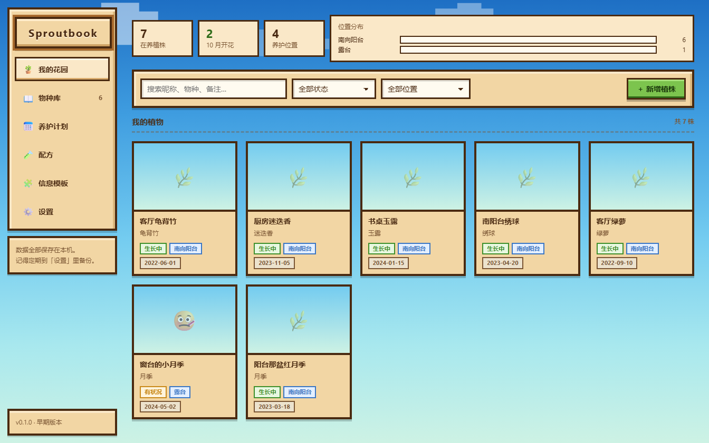
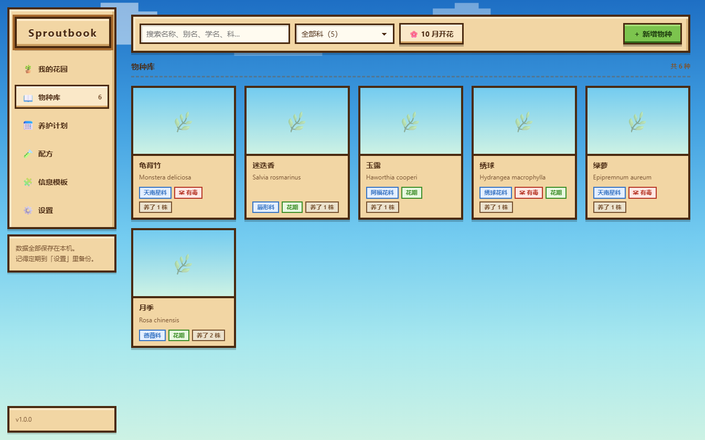
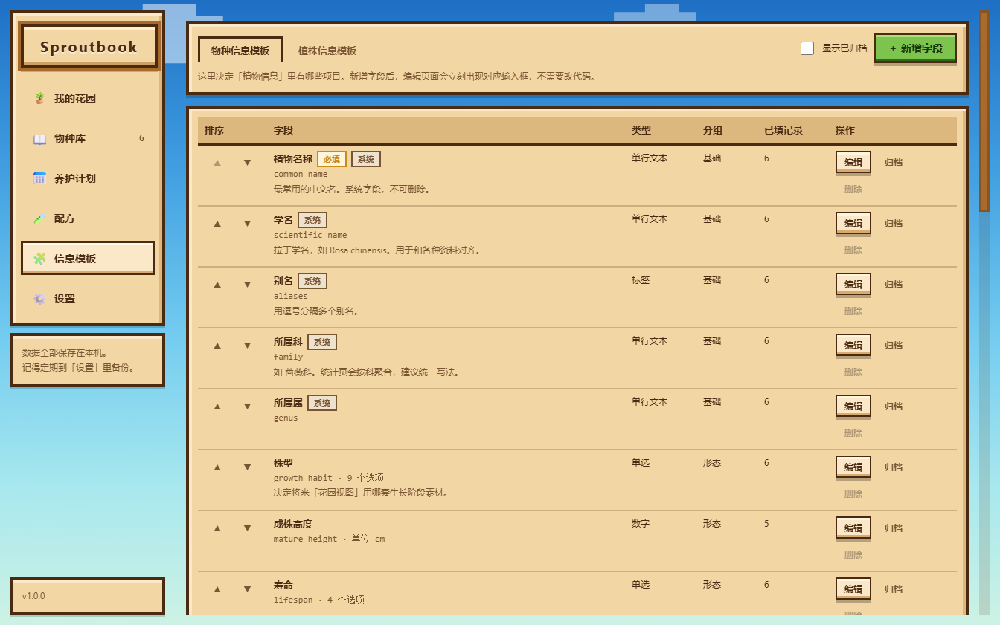
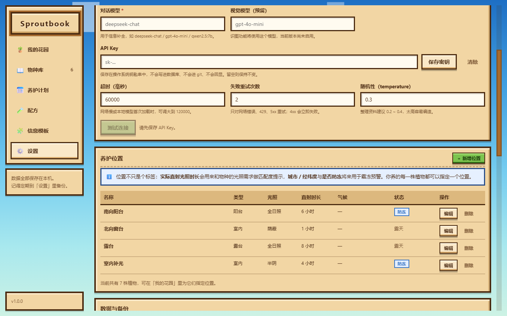

# Sproutbook 🌱

像素风（farm-sim 风格）的**植物养护管理桌面应用**。本地优先：数据全部存在你自己的电脑上，没有账号、没有云端。

用「物种库 + 我的植株」两层结构管理植物档案，用可编辑的信息模板定义你想记录什么，用 AI 帮你查资料——但 AI 只是**建议**，永远不会绕过你的确认直接写入。



| 物种库 | 可编辑信息模板 | 设置与养护位置 |
|---|---|---|
|  |  |  |

> 以上截图由应用自身的 `--screenshot` 自检开关生成（见下文），数据来自 `scripts/seed-demo.mjs`。

> 名称 `Sproutbook` 是**暂定代号**，与任何商业游戏无关。仓库内不含任何第三方游戏素材。

---

## 目录

- [现在能做什么](#现在能做什么)
- [设计取舍（为什么这么做）](#设计取舍为什么这么做)
- [快速开始](#快速开始)
- [AI 配置](#ai-配置)
- [数据与备份](#数据与备份)
- [常见问题](#常见问题)
- [路线图](#路线图)
- [English](#english)

---

## 现在能做什么

### ✅ 已实现

| 功能 | 说明 |
|---|---|
| **物种库** | 植物百科信息：名称 / 学名 / 别名 / 科属 / 株型 / **叶形** / **叶色** / **花形** / **株幅** / 花期 / 花色 / 春花需求 / 光照 / 耐热耐寒 / 毒性等 |
| **首页** | 启动就是标题画面：木牌 + 四个入口（**我的花园 / 物种库 / 养护 / 退出**），左下角齿轮进设置。**分区页没有任何导航条**：只有右下角一块「← 后退」，回首页再换分区（信息模板在各自分区的入口里：植株模板在「我的花园」、物种模板在「物种库」） |
| **可编辑信息模板** | 字段是数据不是代码。加一个字段，所有编辑表单立刻生效，无需改前端。**「所属物种 / 养护位置 / 状态」也在模板里**，与其它字段一样可排序、改标签、换分组。支持**条件显示**（如「盆径」只在栽种方式选了盆栽时出现），只隐藏不清值 |
| **我的植株** | 你实际养的那一株：昵称、所属物种、养护位置、**分类（自己分，如「月季类」，用来筛选）**、状态、**栽种方式（盆栽/地栽/水培/附生板）**、**现状高度 / 苗龄**（决定花园里画多大）、入手日期、盆径（仅盆栽时填）、备注、图片 |
| **星露谷式花园视图** | 「我的花园」有两种视图。**🌿 花园**用像素图展示每株长到哪一步 —— 形状由物种的**株型 + 叶形 + 叶色 + 花形 + 株幅**共同决定（同株型的植物也能区分开），**底座由植株的栽种方式决定**（盆栽的乔木就画在盆里），**大小按「实测现状高度 > 成株高度×苗龄 > 成株高度 > 株型推测」四级推算（对数刻度，相邻档位至少差 5%，详情面板会写出显示比例）**，颜色由生长阶段和花色决定，地块上直接标出「这盆该做什么」；**▦ 列表**用于搜索筛选和批量管理。**点任意一株打开同一个弹窗：现状 + 编辑**（封面 / 阶段与依据 / 生成计划 / 物候标记 / 本株信息 / 图片），看完改完一次搞定。像素图是**程序化生成**的（9 株型 × 9 阶段参数化拼装），仓库里没有任何图片资源。选中一株后，详情里可以直接**给这一株生成 / 更新年度计划**（不动别的植株） |
| **养护位置管理** | 位置不只是标签：光照等级与每日直射时长用于匹配度提示；省 / 市 / **区县**与可加温 / 能防冻是**天气预警**的输入 —— 填了城市才会联网，不填就还是纯离线。每个位置还能加**照片**与**备注**（朝南偏东、下午西晒、架子层高这类填表填不出来的东西），照片目前只存不用，留给以后的 AI 分析 |
| **多段月份** | 花期、休眠期可以选多段（月季 4~6 月 **+** 9~11 月），区间只是特例；索引一个月一行，「本月开花」查询天然精确 |
| **列表 / 搜索 / 筛选 / 统计** | 按名称别名 / 分类搜索，按状态、位置、**分类**筛选，按「本月开花」筛选，按最近改动 / 入手时间 / 购入价格排序，位置分布统计 |
| **图片管理** | 上传后复制进应用数据目录并自动生成缩略图，数据库只存文件名。封面**三级兜底**：你指定的那张 → 这一株自己的图 → **物种图库的第一张**（同物种的花长得一样，不用一株株设）；植株编辑器里物种图是**只读**列出来的，点一张可以借来当封面，删不掉也不会复制文件 |
| **导入导出** | 物种 / 植株导出为 CSV（Excel 可编辑）或 JSON（保留原生类型）；导入前先预览列匹配、必填缺失与重名，可选择跳过或覆盖。「所属物种 / 养护位置」导出的是**名字**而非数据库 ID，换台电脑也能用 |
| **配方** | 配土 / 肥料 / 药剂的配法。支持**比例写法**（泥炭 : 珍珠岩 : 蛭石 = 5 : 3 : 2）与**绝对用量**（缓释肥 20 克）两种方式并存；边填边显示比例摘要，输入份数立刻算出「配 10 盆各要多少」。材料库统一管理分类 / 单位 / **已有数量** / **单价**（可估「配一次多少钱」），库外的临时材料也能直接写名字 |
| **天气预警** | 按物种的**耐寒 / 耐热**温度 + 养护位置能否防冻/加温，判断未来 7 天谁需要防冻、谁需要防暑。**没填城市就完全不联网** —— 这是应用里唯一的网络功能，不填就等于不存在。数据来自 Open-Meteo（免费无需 key）或**和风天气**（配 key，可精确到中国的区县）—— 前者认不出某县县这类区县，后者能。失败时安静跳过。显示在「今日」页 |
| **养护规则** | 规则的频率有三种：区间内每月一次、**整段里只做一次**（底肥这类一季只做一次的事）、每隔 N 天。规则写的是**日期区间**：「起始」月份 + 几号（默认 1 日）到「结束」月份 + 几号（默认月底）。每月一条的规则日期取每个月的起始日，结束日负责收口；小月自动按当月天数算。规则还能**绑定配方** —— 任务卡片直接列出材料清单，完成后日志会记下当时用的哪份配方 |
| **养护 · 今日** | 「养护」里的第一个 tab（侧栏角标就是「今天压着几件事」）：**今天到期和已过期的任务**直接勾完成 / 跳过，勾错就地撤销。**同一条规则、同一天的多株分组显示**（组头写一次标题 / 日期 / 可做期 / 说明，组里每株仍是独立一行，各自完成、各自备注 —— 日志按株记）。任务的**可做期从到期日开始、到规则区间的结束日为止**（例如 10 月的任务整个 10 月都能做），所以提前不会冒出来、也不至于月中就「已过期」。最上面是**天气预警**（当天与未来 24 小时、当天建议、谁需要防冻防暑） |
| **养护 · 养护计划** | 「养护」里的第二个 tab。默认**月历**：一眼看清这个月的节奏。格子里**实标**是当天到期的任务，**虚标**是「到期日在更早、时间窗还开着」的待办（按规则合并成「×N」，一格最多 3 个标签）。**点某一天，右侧列出当天全部计划**——当天到期的加上时间窗内可补做的，同一条规则的多株**分组显示**（组头写一次标题 / 日期 / 说明，组里每株可查看 / 编辑 / 删除，执行动作在「今日」页），也能给这天单独加一条。规则库按「哪个月做什么」定义（内置 20 条，可增删改），规则可**同时适用于多个物种**。支持**周期与轮换**与**物候阶段**（生长期 / 花芽分化期 / 花期 / 休眠期 / 缓苗期 / 种子种球期 / 病虫害期；阶段由**状态 + 物种花期**自动推算，不再手点）。任务的可做期由规则区间决定，不是固定死线。生成计划在「我的花园」里按株进行。工具栏的**「导出计划」**把所选植株的**全年计划**导出成一份独立 HTML（封面 / 统计 / 每月密度 / 12 个月任务清单，单文件可离线看、可直接打印） |
| **养护日志** | 独立的一页：完成任务时自动写一条，也可以手动记一笔（选植株 + 选类型 + 一句话）。**每条记录可以带照片**（多张，缩略图 + 点开看大图，也可以只放照片不写字）；**每条都能编辑**（类型 / 日期 / 正文 / 照片增删），删记录时照片文件一起清理。按日期倒序列成时间线，按植株筛选，删除不可恢复（会确认） |
| **识图生成** | 选一张照片（PNG / JPG / WebP / BMP），模型给出 Top-3 候选。**它只负责认出是什么**，认出后交给下面那条补全流程。候选会标明**认到了哪一层** ——「到品种 / 到种 / 只到属」；认不出品种就老实停在种，不编一个听起来像的名字。识图时会把**你库里已有的物种名**一并告诉模型，把开放问题变成选择题。图片先缩到长边 1024 再发；用 `deepseek-flash` 即可（官方唯一支持视觉的模型） |
| **AI 自动补全** | 输入植物名 → 生成字段草稿 → 逐字段勾选确认后才写入；**安全字段强制人工核实**，且可逐个标记 / 撤回 |
| **声音与背景** | 设置里可以**上传 / 切换 / 删除**背景音乐与背景图，各自有「打开目录」直达 `<数据目录>/textures/music` 与 `backgrounds`。背景支持三种模式：只用主题自带的、主题 + 自己的全部轮播、或单选某一张；选中的偏好存在数据库里，重启后仍然生效。背景图读出来会先缩到最长边 1600 再转 JPEG，避免十几 MB 原图把界面卡一下 |
| **备份与恢复** | 启动 / 退出 / 结构升级前自动滚动备份，也可手动立即备份 |
| **启动自诊断** | 启动日志记录参数、关键路径可写性与窗口显示情况；页面级错误边界避免白屏 |

> 还没做的功能与顺序见文末的[路线图](#路线图)。

---

## 设计取舍（为什么这么做）

这部分解释了代码里那些看起来「多此一举」的设计，也是后续开发的约定。

### 1. 物种（species）与植株（plants）必须分两层

「月季的科是蔷薇科」是**物种级知识**，养三盆月季不需要抄三遍，AI 也只需要补全一次。
「这盆月季是 2023 年买的」是**实例级数据**，每株都不同。

所以：`species 1—N plants`，AI 补全与图片挂两边各取所需，统计按物种聚合。

### 2. 可编辑模板 = JSON 列 + 索引投影表

没有用「动态 ALTER TABLE」（迁移地狱），也没有用纯 EAV（查询拼装复杂）。
字段值存在 `attributes_json`，同时投影到 `attr_index` 表：

- 多值字段（多选、标签）→ 一行一个值
- 月份字段（花期 4~6 月 + 9~11 月）→ 一行一个月，多段就是多行，查询无需字符串切分

于是「本月开花」是一次普通的索引命中，而不是在 SQL 里切 JSON 字符串。
投影是**纯派生数据**，随时可以从 JSON 全量重建（自检里就有一项专门验证重建前后一致）。

### 3. 字段只归档，不物理删除

删字段等于删数据。系统字段不可删不可改类型；已被使用的字段只能归档；
只有从未被填写过的字段才允许真删。改类型时界面会明确告知影响面。

### 4. 用 `node:sqlite`，不用 better-sqlite3

`better-sqlite3` 是原生模块，需要本地编译或匹配 ABI 的预编译包，在没有 MSVC 构建工具的机器上直接装不上。
`node:sqlite` 是 Node 22+ 内置的，**零原生依赖、零编译**，对「任何人 clone 下来就能跑」和 CI 稳定性是决定性的。

代价：它只接受 `string / number / bigint / null / Uint8Array` 作为绑定值，
**传 boolean 或 undefined 会直接抛错**。这个坑统一收口在 `src/main/db/connection.ts` 的 `normalize()` 里。

### 5. AI 永远不会绕过确认

- AI 产出的是**草稿**，界面上逐字段勾选后才写入
- 安全字段（毒性、有毒部位、中毒症状、急救）额外标记，必须人工核实，界面持续提示
- 安全字段的「待核实」状态精确到字段，不会把用户手填的信息也标成待核实
- **没配 API Key 时全部功能照常可用** —— AI 是增强，不是依赖
- 每次调用写 `ai_runs` 审计表，出问题能复盘「它当时到底收到了什么」

### 6. 领域逻辑与框架解耦

`src/core/` 是纯逻辑：字段类型系统、校验、投影、格式化。零 DOM、零 Node API、零 Electron 依赖。
主进程和渲染进程共用同一份实现，杜绝「两边行为不一致」。
将来要做手机版时，这一层可以原样复用，只需换壳。

### 7. 让检查变成防线，而不是一次性审计

项目做过一次三方向的只读审计（死代码 / 静默失败 / 契约一致性），
修完之后把其中**能自动化的部分做成了常驻检查**，而不是留在报告里：

- **Db.stmt 校验 SQL 占位符与参数数量**，不符当场抛出。
  这里是所有读写路径的唯一入口，改一处覆盖全项目每一条 SQL。
  这类错真的发生过：加字段时改了列名没改参数，整条 UPDATE 静默失效，
  用户看到的现象只有一句「这块修改不了」。更危险的是**少传参数时
  SQLite 会把参数按位置错配** —— 直接失败远好过悄悄写错数据。
- **scripts/verify.mjs 一条命令跑完类型 → 自检 → 构建（→ 打包），
  任何一步失败立刻停**。它的存在本身就是教训：在那之前步骤是在命令行里
  现拼的，还加了管道把输出和退出码一起截掉，于是「类型检查失败」和
  「命令跑完了」看起来一模一样 —— 结果提交过一个类型检查失败的版本。

### 8. 一个自检，两个入口


`src/main/smoke.ts` 把整条数据链路真实跑一遍（迁移幂等、绑定归一化、投影展开、
部分更新不丢字段、必填校验、字段删除保护、投影重建一致性、备份产出），
**不依赖 Electron、也不依赖打包器**，所以既能当 CI 冒烟测试，也能在真实运行时里跑。

---

### 9. 改数据形状时，必须同时考虑**已经存在的数据**

这是个本地优先的应用：**数据一直在用户自己的机器上，版本升级时老数据就在那儿。**
所以「加一个字段」从来不只是改一行类型声明 —— 它会同时遇到三种老数据：
数据库里的旧行、缓存里的旧结构、别人导出的旧文件。

**这件事已经咬了四次**，而且前三次都是静默的：

| 改了什么 | 老数据怎么了 | 用户看到 |
|---|---|---|
| 给 `environments` 加 `district` | SQL 加了列但没同步参数列表 | 「这块修改不了」——整条 UPDATE 静默失效 |
| 给 `care_tasks` 加 `rule_id` / `recipe_id` | 旧任务从没被回填 | 任务卡上少了规则和配方，看不出哪里不对 |
| 给天气缓存加 `hours` | **旧缓存里没有这个字段** | 养护计划页直接白屏 |

第三次是唯一一次**当场崩掉**的 —— 反过来说，它也是唯一一次**立刻被发现**的。
前两次是静默失效，用户只会觉得「改了没用」，而不会想到是数据形状的问题。

**分界线在于：读的时候有没有设防。**

- 新字段读出来是 `undefined`，然后 `.length` / `.map()` → 崩，你会知道
- 新字段读出来是 `undefined`，然后 `?? []` 兜住 → 静默少一块，你不会知道
- 写的时候参数对不上 → 静默不写，你更不会知道

**所以规矩是三条：**

1. **读老数据一律设防**（`?? []`、`?? null`），别假设字段一定在
2. **缓存的形状变了就当作过期**，重新取一次；取不到再退回老数据 ——
   别硬用一份不再满足需要的缓存
3. **改 SQL 的参数列表时，用 `Db.stmt` 的占位符校验兜住**（见第 7 条）——
   它会在参数数量对不上的当场抛出，而不是等用户报「改不了」

#### 派生值也要版本化（同一天咬了三次）

第 9 条讲的「改数据形状」有一个更容易漏的子类：**改的不是数据的形状，
而是「从原始数据算出结果」的规则。**

缓存里存的往往不是原始响应，而是**算过的东西**。规则一变，旧结果就是错的，
**但形状完全合法** —— 于是它不会崩，只会悄悄显示错的东西。

| 改了什么 | 缓存里的旧值 | 用户看到 |
|---|---|---|
| 给逐时加 `hours` 字段 | 没有这个字段 | **白屏崩掉** |
| 给和风的夜间图标 150–153 补映射 | 那几小时仍是旧规则算的 `null` | 「天气未知」 |
| 修 `level` 的判断（「到区县还是只到市」） | 仍是旧规则的 `'city'` | 「只到市」，而地名明明是四级 |

第一次崩了，**所以立刻被发现**。后两次没崩 ——
用户会以为功能没做，而不会想到是缓存旧了。**不崩的那两次反而更难查。**

所以缓存条目里带一个**解析规则版本**：改翻译规则时把它加一，
旧条目自然失配、重新取一次。

- 天气预报缓存：`PARSE_VERSION`（`src/main/services/weather.ts`）
- 地名解析缓存：键前缀 `geo-v2`（`src/main/services/weather-providers.ts`）

**判断标准很简单：只要「同一份原始响应，新版本算出来的结果会和旧版本不一样」，
就要动版本号。**

顺带一条：**把原始值也存下来**。逐时天气里留了一个 `raw`（WMO 编码或
和风图标号）。那次界面上显示「天气未知」，手里只有映射后的 `null`，
**根本不知道数据源给的是什么号** —— 只能猜，而我猜错了两次。
存下原值，下次不用猜。

反面的样板是 `pot_size` → `pot_size_cm` 那次迁移：**老键被刻意留着**，
而不是删掉。这样用户在「未归档字段」里还能看见它，
取消归档也能恢复原值 —— 那一次是想清楚了的。

### 10. 每个「通过」都必须对应一个可证伪的检查

这条不是关于代码的，是关于**怎么判断代码是对的**。

同一个毛病在一天里出现了五次，形态各不相同：

| # | 那句「通过」 | 实际发生了什么 |
|---|---|---|
| 1 | `tsc` 跑完了 | 输出被管道截断了，**退出码没人看** —— 于是提交了一个类型检查失败的版本 |
| 2 | 补丁脚本打印「✓ 已加入」 | 正则没匹配上，**什么都没改** |
| 3 | 界面弹「已删除」 | 底层已经改成返回 `false`，**界面没看那个返回值** |
| 4 | 截图看着正常 | 只截了**成功路径**，失败态从没验证过 |
| 5 | `verify --pack` 报「✓ 全部通过」 | **打包产物少拷了一半文件**，用户装上启动就崩 |

**共同点：把「命令跑完了」当成了「事情做对了」。**

第 5 次是唯一一次后果落到用户身上的 —— 前四次骗的都是我自己。

#### 所以定几条规矩

**一、退出码要真的被检查。** 不要把命令的输出接进管道再截断 ——
`Select-Object -First 5` 这类东西会把退出码一起吃掉，
于是「失败」和「跑完了」在屏幕上长得一模一样。
用 `scripts/verify.mjs`：**任何一步非零就立刻停**。

**二、只在成功路径上验证过的检查，等于没有检查。**
- 加载失败态是**临时把 `species:list` 改名、真跑一遍**看到的
- `verify.mjs` 的「失败就停」是**故意弄坏 `tsconfig` 验过**的
- 旧缓存崩溃是**写脚本造一份旧形状的缓存**复现的

**三、产物要验产物。** 缺的是 Electron 自己的运行时（ICU 数据、pak、DLL），
**任何代码层面的检查都发现不了** —— 只能打包后逐一确认文件在不在。

**四、测试红了先怀疑自己的断言。** 这一天里有三次是**断言错、代码对**
（SQL 占位符数、换源文案少一个「的」、重复归档该返回 `true`）。
也有一次是**代码错、断言对**（WMO 的雷暴少了上界，任何大数字都变雷暴）。
**两种都有，所以不能一律怀疑一边 —— 要去看数据。**

#### 最后一句

**「没报错」和「做对了」是两件事。**
这一天的教训是：**只要没有一条能失败的路，那句「通过」就没有信息量。**

## 快速开始

### 环境要求

- **Node.js ≥ 20**（推荐 22 / 24）
- **pnpm**（推荐；npm 也能用，但构建脚本白名单是本仓库按 pnpm 配的）
- Windows / macOS / Linux

### 安装与运行

```bash
pnpm install
pnpm dev          # 开发模式（热更新）
```

首次 `pnpm install` 时 pnpm 会提示有依赖被禁止执行安装脚本（`ERR_PNPM_IGNORED_BUILDS`）。
本仓库已在 `pnpm-workspace.yaml` 里放行了必需的 `electron` 与 `esbuild`，正常情况不会出现该提示。
若新增依赖触发提示，请先确认该包确实需要脚本再放行。

### 自检与构建

```bash
pnpm smoke        # 数据层端到端自检（不需要 Electron，适合 CI）
pnpm typecheck    # 类型检查（主进程 + 渲染进程）
pnpm build        # 类型检查 + 打包前端产物到 out/
pnpm dist:win     # 生成 Windows 安装包到 release/
pnpm dist         # 按当前平台打包
```

界面自检（用于排查白屏 / 渲染崩溃这类只在真实窗口里暴露的问题）：

```bash
electron . --screenshot=out.png                          # 截图后自动退出
electron . --screenshot=out.png --screenshot-route=settings   # 截指定页面
```

支持的路由：`garden` / `species` / `today` / `plans` / `logs` / `recipes` / `templates` / `settings`。
界面本身也用 URL hash 记路由（`#/species`），刷新不会跳回首页。

升级 Electron 版本后，建议跑一次运行时能力探测，确认数据库层依赖的假设仍然成立：

```bash
ELECTRON_RUN_AS_NODE=1 electron scripts/runtime-probe.cjs   # Windows: 用 cmd 执行
```

它会验证 `node:sqlite` 是否可用、WAL 能否开启、以及**布尔值/undefined 是否仍会被拒绝绑定**
（这是本项目在 `connection.ts` 里做归一化的原因）。

### 体验演示数据

不想手动录入也能看到完整界面：

```bash
node scripts/seed-demo.mjs .cache/demo
electron . --data-dir=.cache/demo
```

`--data-dir=<目录>` 会把数据目录指到别处（便携模式 / 多套数据 / 测试隔离），不影响你的正式数据。

### 国内网络

`.npmrc` 已配置 npmmirror 镜像（registry、Electron 二进制、electron-builder 二进制）。
若你的网络环境不同，删掉或修改 `.npmrc` 里的 `*_mirror` 即可。

---

## AI 配置

「设置 → AI」里填写，支持**任何 OpenAI 兼容接口**：
OpenAI、DeepSeek、Moonshot、智谱 GLM、OpenRouter、本地 Ollama / LM Studio，
以及各类中转网关。界面上内置了几个常用预设，选一下会自动填好地址与模型名。

- **接口地址（Base URL）**：通常以 `/v1` 结尾。应用会访问 `{地址}/chat/completions`
- **对话模型**：用于信息补全
- **视觉模型**：为将来的识图功能预留
- **API Key**：保存在操作系统钥匙串（Windows DPAPI / macOS Keychain / Linux libsecret），
  **不写数据库、不进 git、不回显**。若系统钥匙串不可用，会降级为明文保存并**明确提示你**
- **超时 / 重试**：只对网络错误、429、5xx 重试；4xx 立即失败并给出服务端原文
- **测试连接**：先尝试列出模型，不支持时改用一次极短对话验证

> ⚠️ 安全提醒：AI 在**毒性、有毒部位、急救处理**这类信息上可能出错。
> 应用会把这类字段标记为「待核实」并持续提示，但**最终判断请务必对照可靠资料**。
> 涉及儿童或宠物误食风险的场景，不要仅依赖本应用。

---

## 数据与备份

所有数据都在你的用户目录下（「设置 → 数据与备份」里可以直接打开）：

| 内容 | 位置 |
|---|---|
| 数据库 | `<用户数据目录>/data/sproutbook.db` |
| 图片 | `<用户数据目录>/images/` |
| 自动备份 | `<用户数据目录>/backups/`（滚动保留最近 5 份） |
| API Key | `<用户数据目录>/secrets/credentials.json`（系统钥匙串加密） |

备份文件是完整的 SQLite 数据库，可以直接复制保存。应用在**每次启动、退出、以及数据库结构升级前**都会自动备份。

---

## 常见问题

**双击 `Sproutbook.exe` 没反应 / 一闪就没了（异常码 `0x80000003`）**

按下面的顺序排查。**第 ① 步最容易被忽略，也最容易被误判成「Chromium 沙箱坏了」——
但它是真实项目里最常见的原因，先查它。**

### ① 先查程序目录的权限（最常见）

在 PowerShell 里对**程序所在目录**执行：

```powershell
icacls "C:\你的\程序目录"
```

输出里只要出现下面任意一项，就是这个问题：

| 看到什么 | 含义 |
|---|---|
| `Mandatory Label\Low Mandatory Level` | 可执行文件被打上了低完整性标签 |
| `S-1-4-...`（AppContainer 能力 SID） | 文件被某个沙箱环境标记过 |
| `Everyone:(DENY)(DC)` | 显式拒绝删除子项 |

**典型症状：同一个 `Sproutbook.exe`，右键「以管理员身份运行」能起来，普通双击不行。**
这是因为管理员令牌能绕开这些限制。同一个原因还会导致：

- 安装程序报「Sproutbook 无法关闭」—— 它没法替换被 `DENY Delete Child` 保护的文件
- 事件查看器里出现 `0x80000003`（STATUS_BREAKPOINT），看起来像沙箱崩溃

**这些标记是怎么来的**：如果在**受限/沙箱化的环境里构建**（低完整性终端、某些 CI runner、
带目录沙箱的 Agent 工具等），构建过程产生的**每一个**文件都会带上这些标记 ——
包括 `node_modules` 里的 `electron.exe`。打包时它被原样复制成产物里的 `Sproutbook.exe`，
于是污染代代相传，**换目录重新 `git clone` 也没用，因为 `node_modules` 会被重新装成脏的**。

**修复（管理员 PowerShell）**：

```powershell
$dir = "C:\你的\程序目录"
icacls $dir /reset /T /C /Q
icacls $dir /setintegritylevel "(OI)(CI)Medium" /T /C /Q
```

> ⚠️ `"(OI)(CI)Medium"` 的括号**必须加引号**。不加的话 PowerShell 会把 `(OI)` 当成命令，
> 报「无法将"OI"项识别为 cmdlet」。

修完用 `icacls` 复查，确认 `Low Mandatory Level` / `S-1-4-` / `DENY` 都消失了，
然后**重新执行完整构建**：

```bash
rmdir /s /q release
pnpm install        # 必须重装：node_modules 是污染源
pnpm dist:win
```

> 只删 `release` 重打包是不够的 —— `node_modules` 里的 `electron.exe` 还是脏的，
> 而它会被原样复制成 `Sproutbook.exe`。

### ② 检查是不是在受限终端里启动的

```powershell
whoami /groups | Select-String "Mandatory"
```

- `Medium Mandatory Level` = 正常
- `Low Mandatory Level` = 你正处在一个受限环境里（沙箱化终端、部分远程会话、CI runner）。
  Chromium 的进程沙箱需要创建受限令牌并派生中等完整性的子进程，低完整性令牌做不到，
  **必然崩溃**。换一个普通终端，或在 Windows 资源管理器里直接双击即可。

### ③ 检查安全软件

360、火绒、腾讯电脑管家等会注入进程、破坏沙箱初始化。临时退出后测试即可确认。

### ④ 以上都排除了，才考虑沙箱兜底

与 exe 同目录的 `Sproutbook-compat.cmd` 会额外传入 `--no-sandbox` 与 `--disable-gpu`：

```
Sproutbook.exe --no-sandbox --disable-gpu
```

或者用**兼容模式快捷方式**：`设置 → 启动兼容性 → 在桌面创建兼容模式快捷方式`，
它用 Electron 内置的 `shell.writeShortcutLink` 生成一个原生 `.lnk`，
把参数烘焙进去，之后双击桌面图标即可。

> 安全影响：关闭渲染进程沙箱会降低隔离强度。本应用只加载本地文件、CSP 已禁止一切远程资源、
> `contextIsolation` 开启、`nodeIntegration` 关闭，因此风险可控；但**它是绕过症状，不是修复**，
> 请务必先走完 ①②③。

**补充事实（已实测）**：应用**无法**在启动时自救 —— 曾经实现过「标记文件 +
`app.commandLine.appendSwitch('no-sandbox')`」，实测仍然是 `0x80000003`，
因为 Chromium 的沙箱初始化早于主进程 JavaScript。所以 `--no-sandbox` 只能出现在命令行上。

### ⑤ 其他

- 修复系统文件：`sfc /scannow`，必要时再跑 `DISM /Online /Cleanup-Image /RestoreHealth`
- 检查是否启用了 AppContainer / Device Guard / 应用控制相关策略

### 仍然无解时

应用会写启动日志，里面记录了启动参数、三个关键路径、**每个目录的可写性探测**，
以及窗口是否成功显示：

```
%APPDATA%\Sproutbook\startup.log
```

把它发出来通常一眼就能定位。

**Windows 提示「已保护你的电脑」/ macOS 提示「已损坏」**
安装包没有代码签名，这是正常现象。Windows：点「更多信息 → 仍要运行」。
macOS：右键点图标选「打开」，或执行 `xattr -dr com.apple.quarantine /Applications/Sproutbook.app`。

**为什么节点包安装要用 hoisted 布局？**
pnpm 默认的符号链接布局在 Windows 上会创建 junction，而 Node 的 ESM 解析器在部分路径下不会 realpath 它们，
导致 Vite 工具链解析不到自己的传递依赖。扁平布局让任意层级的解析都能成功。
详见 `pnpm-workspace.yaml` 里的注释。

**`pnpm dist` 打包失败怎么办？**

打包路径上有两处已知的上游坑，仓库都已修正，如果你改动依赖树后复现，按下面排查：

| 报错 | 原因 | 修正位置 |
|---|---|---|
| `Cannot read properties of undefined (reading 'ReadWrite')` | electron-builder 26 声明 `@electron/get: ^3.0.0`，但代码要用 3.1.0 才有的 `ElectronDownloadCacheMode` | `pnpm-workspace.yaml` 里的 `overrides` |
| `No JSON content found in output` | electron-builder 调用 `pnpm list --json` 收集依赖树，而 pnpm 11 会在 JSON 前后打印供应链校验横幅 | `build/before-build.cjs` 返回 `false`，跳过依赖收集（本项目零运行时依赖，语义上就是对的） |
| `unable to verify the first certificate` | 打包时想重新下载 Electron（公司代理 / TLS 中间人） | `electron-builder.yml` 的 `electronDist` 直接复用已下载的运行时，打包完全离线 |

**注意**：若将来引入了**运行时**依赖（即需要真实存在于 `node_modules` 里的包），必须删掉 `electron-builder.yml` 里的 `beforeBuild` 配置，否则那些依赖不会被打进安装包。

**数据库能直接用别的工具打开吗？**
能。就是标准 SQLite 文件。但请注意：`attr_index` 是派生表，手改 `attributes_json` 后筛选会不一致——
在应用里重新保存一次记录即可自动同步。

---

## 路线图

| 版本 | 内容 | 状态 |
|---|---|---|
| **v0.1** | 物种库 / 可编辑模板 / 植株管理 / 搜索统计 / 图片 / AI 补全 / 备份 | ✅ 已完成 |
| **v0.2** | 导入导出（CSV / JSON）、养护位置管理、多段月份、`relation` 字段类型 | ✅ 已完成 |
| **v0.3** | 配方（材料库 + 比例/用量 + 换算） | ✅ 已完成 |
| **v0.3** | 养护计划（规则库 + 任务生成 + 时间窗 + 月历 + 完成打勾 + 养护日志时间线 + 侧栏角标） | ✅ 已完成 |
| **v0.3** | 养护规则的**周期与轮换**（每 N 天一轮、多肥循环） | ✅ 已完成 |
| **v0.3** | **物候阶段**（规则限定生效阶段，用以表达「什么时候停」） | ✅ 已完成 |
| **v0.4** | **星露谷式花园视图**（生长阶段推导 + 程序化像素美术 + 场景页） | ✅ 已完成 |
| **v0.4** | **物种形态性状**（叶形 / 叶色 / 花形 / 株幅 —— 让同株型的植物也能区分开） | ✅ 已完成 |
| **v0.4** | **字段条件显示**（如「盆径」只在栽种方式选了盆栽时出现） | ✅ 已完成 |
| **v0.4** | 「窗口内只做一次」的规则、规则绑定配方 | ✅ 已完成 |
| **v0.4** | 天气与霜冻预警（Open-Meteo 免注册 + 可选和风天气到区县）、高温提示停施水溶肥 | ✅ 已完成 |
| **v0.6** | 养护计划导出（单株全年 → 独立 HTML，带封面，可打印） | ✅ 已完成 |
| **v0.5** | 配方与植株的关联（记录「这盆用的是什么土」） | 计划中 |
| **v1.41** | **阶段自动推算**：状态（人工观察）与物候阶段（自动）拆开；编辑器里「现状」移到最下面 | ✅ 已完成 |
| **v0.5** | **识图生成**（拍照 → 候选 → 确认 → 走原有补全流程） | ✅ 已完成 |
| **v1.39** | 声音与背景（上传 / 切换 / 打开目录）、养护位置照片与备注、新增「种子/种球期」「病虫害期」两个阶段 | ✅ 已完成 |
| **v1.0** | 月历导出成图片、双语、代码签名 | 计划中 |
| **v1.x** | 移动端（复用 `src/core` + 换壳）、真推送通知 | 计划中 |

### 🚧 计划中

- **配方与植株的关联**：现在配方绑在**规则**上（「这个品种该怎么配土」），
  但没绑在**植株**上（「这一盆当初用的是什么」）。换盆时要查的是后者 ——
  打开那株植物就该看到它上次用的什么土，而不是自己去翻哪条规则适用于它。
- **植株卡片上的一键阶段**：标记阶段现在要打开植株详情再点。阶段切换已经会按需重排
  这一株的任务（没有计划就不生成），缺的只是把常用的一两个阶段放到卡片上直接点。

---

## 私有素材（可选，不随仓库分发）

界面默认全部是代码画出来的（木牌、面板、按钮、云、草地）。
如果你本机想换成自己的图片（例如从游戏里截的图），把它们放进应用数据目录即可：

```powershell
node scripts/install-textures.mjs D:\素材
# 便携模式 / 指定数据目录：
node scripts/install-textures.mjs D:\素材 --data-dir=D:\sproutbook-data
```

| 文件名 | 作用 |
|---|---|
| `home-bg.png` | 首页整屏背景 |
| `sign.png` | 首页木牌（整张图，自带标题字） |
| `button.png` | 首页四个按钮的底图 |
| `panel.png` | 所有木色面板的底图 |
| `cloud.png` | 云的贴图 |
| `music/*.mp3` | 背景音乐（放 `textures/music/` 子目录，循环播放第一首） |
| `sign.jpg` | 整块木板标题（自带文字，比例自动适配） |

素材包（人物、地图、图块、位图字体）大部分和本应用无关；可用的只有对话框九宫格、
标题按钮、云朵贴图和"后退"按钮，这些需要切图后再接。

### theme.json（素材包进阶用法）

`textures/theme.json` 支持子目录、图集裁切和九宫格：

```json
{
  "slots": {
    "sign":  { "file": "image/logo.png" },
    "panel": { "file": "Stardew valley Material pack/LooseSprites/DialogBoxGreen..png",
               "crop": { "x": 16, "y": 16, "w": 160, "h": 160 }, "slice": 24 },
    "cloud": { "file": "Stardew valley Material pack/Minigames/Clouds..png",
               "crop": { "x": 262, "y": 332, "w": 166, "h": 106 } }
  },
  "backgrounds": ["image/bg_winter.png"]
}
```

- `file` 相对 textures 目录；`crop` 是源图像素坐标；`slice` 是九宫格边距
- `backgrounds` 决定巡视背景的图片（最多 8 张），**所有页面共用**
- 没有 theme.json 时退回「sign.png / home-bg.png …」的约定文件名

除上面五个固定名字外，**其余图片**会当成首页背景：铺满窗口、镜头缓慢平移巡视
（最多 8 张，每 26 秒淡入下一张，每张 34~46 秒巡一遍，方向随机）。

开发期也可以直接放在仓库根目录的 `textures/`（已加入 .gitignore，不会被提交）；
正式安装后请放到 `%APPDATA%\Sproutbook\textures\`，或用上面的安装脚本。

- 放在 `<应用数据目录>/textures/`（Windows 默认 `%APPDATA%\Sproutbook\textures`）
- 支持 png / jpg / webp，单张 ≤ 6 MB；重启生效
- **这些图片不会进仓库、也不会进安装包**。商业游戏的素材受版权保护，
  只建议你自己本机使用，不要分发

> 注意：我（助手）不会把星露谷 wiki 上的图片抓下来打进应用 —— 那是版权素材。
> 这条通道是给你自己准备的图片用的。

---

## 私有字体（可选，不随仓库分发）

界面默认用 **Fusion Pixel**（OFL）。如果你本机想换成别的点阵字体（例如 HZK / IPix 系），
不用改代码，把字体文件放进应用数据目录即可：

```powershell
node scripts/install-font.mjs D:\fonts\你的字体.woff2
# 便携模式 / 指定数据目录：
node scripts/install-font.mjs D:\fonts\你的字体.woff2 --data-dir=D:\sproutbook-data
```

- 目录：`<应用数据目录>/fonts/`（Windows 默认 `%APPDATA%\Sproutbook\fonts`）
- 应用启动时读取其中的字体，注册为 `Sproutbook Custom`；加载失败就继续用 Fusion Pixel
- **这类字体不会进仓库、也不会进安装包** —— HZK / IPix 的字模版权状态不清晰，
  只适合本机私有使用

---

## 许可

代码：MIT（见 [LICENSE](LICENSE)）。

界面**不包含**任何第三方游戏的美术资源：云、木牌、草地、图标都是 CSS / SVG / 字符网格画出来的。
唯一的第三方素材是**像素字体 Fusion Pixel 12px**（OFL 1.1），文件在
`src/renderer/src/assets/`，许可见同目录 `FUSION-PIXEL-OFL.txt`。
来源与许可记录见 [CREDITS.md](CREDITS.md)。

---

## English

**Sproutbook** is a local-first, pixel-art styled desktop app for managing your houseplants.

Records are split into two layers that most plant apps conflate:

- **Species** — encyclopedic knowledge (family, toxicity, cold hardiness, bloom months). Shared, AI-fillable, one entry per species.
- **Plants** — the actual pot on your balcony (nickname, location, status, acquired date, photos).

An **editable field template** defines what you can record: fields are data, not code.
Adding a field immediately shows up in every form. Values live in a JSON column and are
projected into an index table, so queries like "what blooms this month?" hit an index
instead of scanning JSON.

**AI is strictly opt-in and never bypasses confirmation.** It produces a draft that you
review field by field. Toxicity-related fields are flagged and must be verified by a human.
The app is fully usable with no API key at all.

Tech: Electron 41 + React 19 + TypeScript 5.9 + `node:sqlite` (zero native compilation).

```bash
pnpm install
pnpm dev        # develop
pnpm smoke      # data-layer end-to-end self-check (no Electron needed)
pnpm dist:win   # package for Windows
```

Licensed under MIT.
