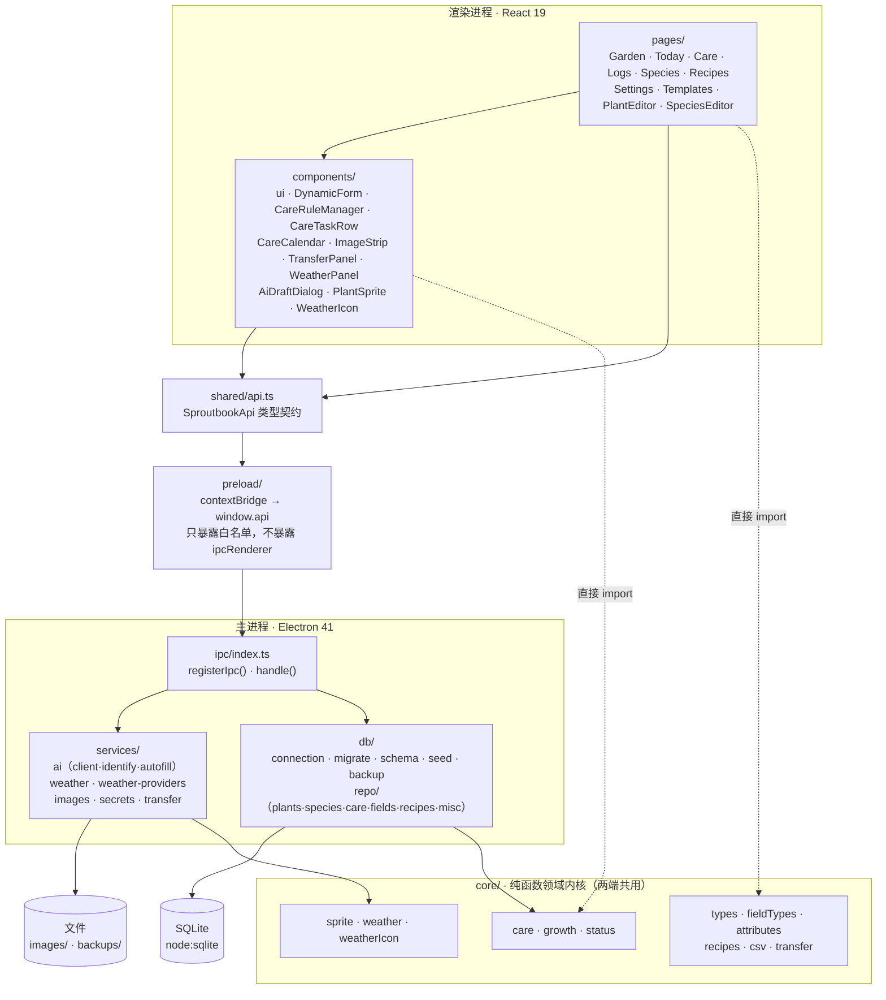
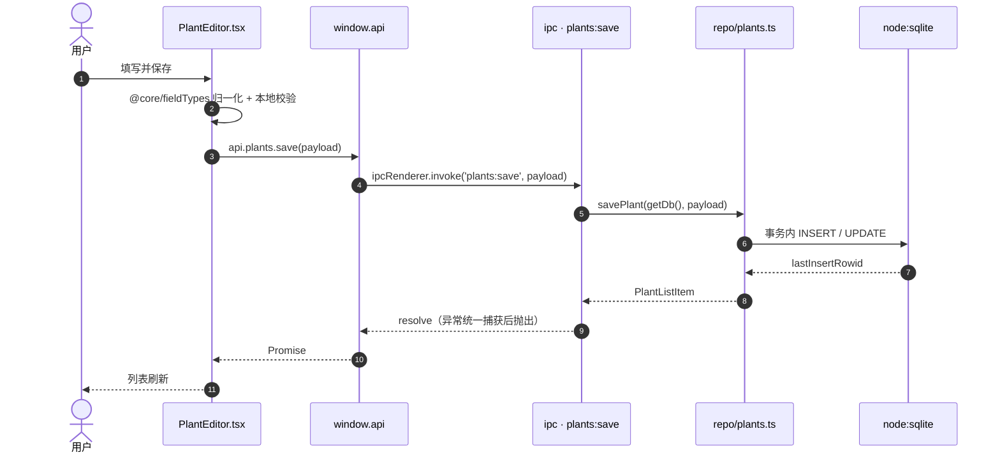
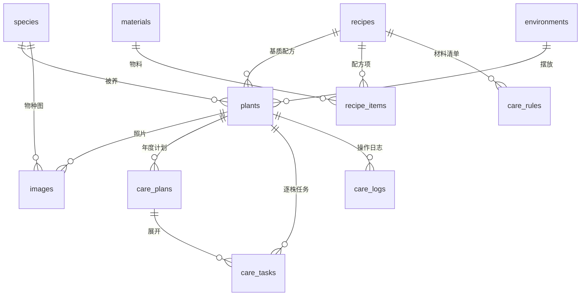
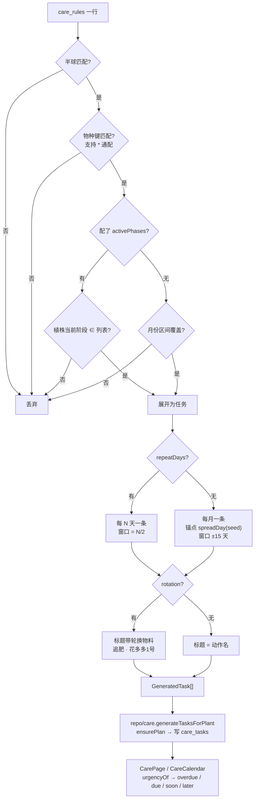
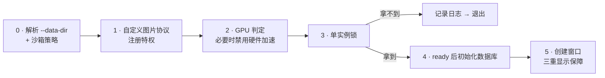

# Sproutbook 架构说明

> 描述 **v1.8.0 的当前实现**。历史设计推演（为什么这么定、放弃了什么）见 [需求分析与技术方案.md](./需求分析与技术方案.md)。
> 图使用 Mermaid，GitHub、VS Code、Obsidian 均可直接渲染。

---

## 1. 技术栈

| 层 | 选型 | 版本 |
|---|---|---|
| 运行时 | Electron | 41.10.7 |
| UI | React + React DOM | 19.1.0 |
| 语言 | TypeScript | 5.9.3 |
| 构建 | electron-vite + Vite | 5.0.0 / 7.3.7 |
| 打包 | electron-builder | 26.15.3 |
| 存储 | `node:sqlite`（Node 内置） | Node ≥ 20 |

**没有原生模块依赖**：数据库走 Node 内置的 `node:sqlite`，不需要 MSVC / node-gyp / 预编译 ABI 匹配。这是「任何人 clone 下来就能跑」和 CI 稳定性的前提。

---

## 2. 进程与分层



### 目录职责

| 目录 | 职责 | 约束 |
|---|---|---|
| `src/core/` | 养护规则、生长、天气、像素精灵、字段类型、CSV/迁移等**纯函数** | 不 `import electron`、不做 IO，因此两端都能用 |
| `src/shared/` | `SproutbookApi` 契约与跨进程 DTO | 只放类型，不放实现 |
| `src/preload/` | 把白名单方法挂到 `window.api` | 不暴露 `ipcRenderer` 本身 |
| `src/main/` | 窗口、IPC 注册、SQLite、AI/天气/图片/密钥服务 | 唯一能碰数据库与文件系统的层 |
| `src/renderer/` | React 页面与组件 | 只能通过 `window.api` 访问主进程 |

路径别名在三份构建配置里一致（`electron.vite.config.ts`）：`@core` → `src/core`，`@shared` → `src/shared`，`@` → `src/renderer/src`。

### 「今日」与「养护计划」的分工（v1.8.3）

两块界面面对的是**同一批养护任务**（`care:tasks`），口径统一在 `core/care.ts` 的 `pendingBuckets`：

| 页面 | 口径 | 能做什么 |
|---|---|---|
| **今日** | 全部未完成任务里 `urgencyOf` = `overdue` / `due`（跨月、跨年）；侧栏角标就是这个数 | 勾完成 / 跳过 / 撤销；看天气预警 |
| **养护计划** | 统计徽章用同一份 `pendingBuckets`（+ 本年已完成）；主体是**月历**，点某一天在右侧列出该日全部任务 | 只看：查看 / 编辑 / 删除；默认月历 |
| **养护日志** | `care:logs`（按日期倒序，可按植株筛） | 手动记一笔 / 删除 |

**生成计划不在养护计划里**：在「我的花园」选中一株，点「生成计划」——
走 `care:generate(plantId, year)`，只动这一株。`care:generateAll` 仍是通道，
但界面不再调用（批量生成会顺手动到别人的计划）。

任务行（`components/CareTaskRow.tsx`）和天气面板（`components/WeatherPanel.tsx`）都是**共享组件**，不各自复制一份 —— 这个仓库为「双份实现」付过代价（`suggestTask` 的副本少了一个「前」字，而自检测的是没人用的那份）。任务行用 `mode` 区分两种用法：`act`（今日，带完成/跳过）与 `manage`（养护计划，只有编辑/删除）。

月历（`components/CareCalendar.tsx`）**整格可点**：点日期 = 选中那天，点格子里的任务 = 选中那天并高亮那一条。选中态与「今天」是两套样式（深色外框 vs 绿色内框），必须一眼分得开。

---

## 3. 一次写操作的调用链

以「保存植株」为例，展示契约层如何把通道名错误挡在编译期：



**关键点**：渲染层调用的方法签名来自 `shared/api.ts`，通道名写错、参数类型不匹配都会在 `pnpm typecheck` 阶段报错，不会变成运行时的静默失败。

---

## 4. 数据模型

15 张表，分三条轴：**知识层 / 实例层**、**养护规则引擎**、**可编辑字段**。



| 分组 | 表 |
|---|---|
| 知识层 | `species`、`field_definitions`、`attr_index` |
| 实例层 | `plants`、`environments`、`images` |
| 配方 | `recipes`、`recipe_items`、`materials` |
| 养护引擎 | `care_rules`、`care_plans`、`care_tasks`、`care_logs` |
| 其他 | `settings`、`ai_runs` |

设计要点：

- **物种与植株分成两层**（`species 1:N plants`）。物种级知识（科属、毒性、耐寒）只存一份，改一次全生效；实例级数据（播种日期、摆放环境）各管各的。
- **可编辑字段是动态的**：`field_definitions` 定义模板，`attr_index` 把值拆成文本/数值两列建索引，所以自定义字段也能搜索和排序。
- **删除一律软删**：`archive*` 系列函数改状态而不是 `DELETE`，`images` / `care_logs` 走 `ON DELETE CASCADE`。

---

## 5. 养护任务的产出流程

这是应用的领域核心：**规则不直接生成日历，而是「规则 × 阶段 × 半球」展开成任务**。



两种节奏的区别：

| 模式 | 触发条件 | 产出 | 适用 |
|---|---|---|---|
| 按月 | 规则未填 `repeatDays` | 区间内每月一条，锚点日由 `spreadDay(year, month, seed)` 打散，窗口 ±15 天 | 「这个月内做都行」的常规养护 |
| 按天 | 填了 `repeatDays = N` | 区间内每 N 天一条，窗口收窄到 `N/2` | 「7~10 天一轮」的追肥/打药 |

**`activePhases` 是「停用」的实现方式**：规则一旦绑定了阶段，就忽略月份区间，只在该植株正处于这些阶段时生效。例：「休眠期停止水溶追肥」＝ 这条追肥规则只在「生长期 / 花芽分化期」生效。

---

## 6. 启动顺序

顺序错了就会出问题，`src/main/index.ts` 顶部有明确约束：



为什么每一步必须靠前：

| 步骤 | 必须早于 | 原因 |
|---|---|---|
| `--data-dir` / 沙箱策略 | `app ready` | 受限环境下 Chromium 沙箱初始化失败会让进程在任何应用代码之前崩溃 |
| 图片协议特权 | `app ready` | 特权注册只在 ready 前有效 |
| 禁用硬件加速 | `app ready` | GPU 进程是 ready 之后才启动的 |
| 单实例锁 | 数据库初始化 | SQLite 单写入者模型，两个进程同时开库会互相锁死 |

⚠️ 单实例锁拿不到时**必须让后续所有初始化停下**。只调 `app.quit()` 不够——它是异步的，`whenReady()` 仍会触发，第二个实例照样去开同一个库，用户看到的就是「数据库初始化失败」。

窗口显示有**三重保障**：`ready-to-show` 正常事件、超时兜底、加载失败兜底。任一路径都会显示窗口——避免「进程在跑但界面永远不出现」的隐身 bug。

---

## 7. 关键设计决策

| 决策 | 理由 | 代价 |
|---|---|---|
| `node:sqlite` 而非 `better-sqlite3` | 零原生依赖、零编译，clone 即跑 | 需要 Node ≥ 22 的运行时；API 较少 |
| `core/` 做成纯函数 | 规则引擎、精灵生成、CSV 解析两端复用，且可脱离 Electron 单测 | 不能在里面直接读数据库或文件 |
| `shared/api.ts` 统一契约 | 通道名/参数错误在编译期暴露 | 改接口要同时改三处 |
| `preload` 白名单 | 不把 `ipcRenderer` 交给渲染层 | 每加一个能力要显式登记 |
| 图片走自定义协议 | 避开 `file://` 与 CSP 的冲突 | 需要注册 scheme + 处理器 |
| AI 只给「候选」不给「结论」 | 视觉模型细粒度识别准确率有限，毒性/科属必须有个人工核实环节 | 多一步确认 UI |
| 删除一律软删 | 误删可恢复，历史统计不丢 | 查询要带 `archived = 0` |

---

## 8. 构建与验证

| 命令 | 作用 |
|---|---|
| `pnpm dev` | 开发模式（electron-vite dev） |
| `pnpm typecheck` | 主进程 + 渲染进程两套 tsconfig 分别检查 |
| `pnpm build` | 类型检查 + 三端构建到 `out/` |
| `pnpm dist:win` | 构建 + electron-builder 出安装包到 `release/` |
| `pnpm smoke` | 无窗口跑完整链路自检（`scripts/smoke.mjs`） |
| `pnpm smoke:electron` | 真实 Electron 里跑 `--smoke`，输出报告 |
| `pnpm verify` | 校验产物/打包结果 |

自检模式（`--smoke`）会切到临时 `userData` 目录，**不碰用户真实数据**；`--screenshot=<path>` 则在窗口渲染完成后截图退出，用于在 CI 里抓「白屏 / 渲染崩溃」这类只在真实窗口才暴露的问题。

---

## 9. 模块地图

```
src/
├── core/          领域内核（13 个纯函数模块）
│   ├── care.ts        规则展开、紧急度、日期运算
│   ├── growth.ts      生长阶段推进
│   ├── weather.ts     天气判定与建议
│   ├── sprite.ts      像素精灵生成
│   ├── fieldTypes.ts  动态字段类型与归一化
│   └── ...
├── shared/api.ts  IPC 契约（约 550 行类型声明）
├── preload/       contextBridge 白名单
├── main/
│   ├── index.ts       启动编排、窗口、单实例
│   ├── sandbox.ts     沙箱与 GPU 降级策略
│   ├── ipc/index.ts   全部通道注册
│   ├── db/            连接、迁移、schema、种子、备份、repo
│   └── services/      ai / weather / images / secrets / transfer
└── renderer/
    ├── src/pages/     10 个页面（Garden · Today · Care · Logs · Species · Recipes · Settings · Templates · PlantEditor · SpeciesEditor）
    └── src/components/ 16 个组件（含 CareTaskRow · WeatherPanel · CareCalendar）
```

---

*本文与代码同步维护。改动分层、通道或数据模型时请一并更新对应图。*
